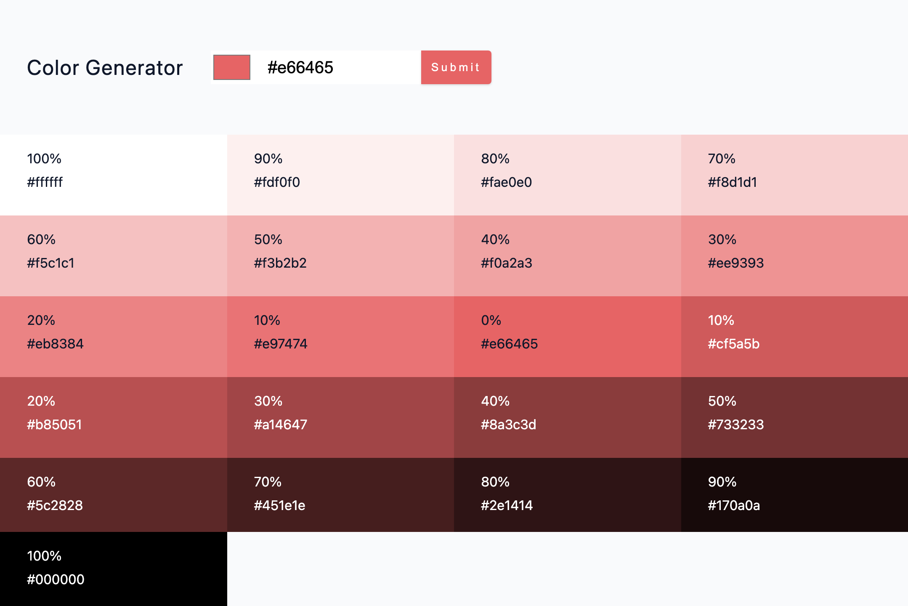

# Color Generator

A responsive React color palette generator that creates lighter and darker shades from a selected color and provides one-click HEX value copying.

## Features
- Generate a complete color palette from a selected color or a hex value.
- Preview lighter and darker shades with their hex codes and percentage weights.
- Validate invalid color values and display feedback with toast notifications.
- Copy any generated color's hex value to the clipboard with one click.
- Responsive CSS Grid layout for browsing the generated palette across screen sizes.

## Built With
- React 18 with functional components and Hooks (`useState`).
- Vite for development and production builds.
- values.js for generating color shades and color metadata.
- React Toastify for success and error notifications.
- CSS3 for responsive layout, design tokens, and component styling.

<!-- do not modify following content -->
## Installation
```bash
npm i
npm run dev
```

## Preview


## Live Demo
[Color Generator](https://09-color-generator.vercel.app/)